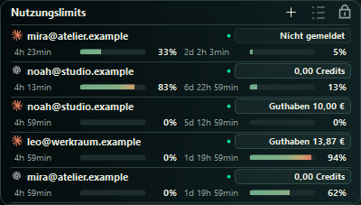
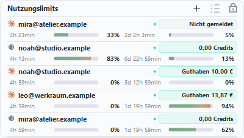

# UseScope

Ein kompaktes Desktop-Widget für KI-Abos, API-Verbrauch, Reset-Zeiten und gemeldetes Guthaben. Direkte Kontoabfragen und ein optionaler lokaler API-Zähler ergänzen sich.

**2.6.2 ist ein lokal vorbereiteter Prüfstand.** Die Liste umfasst 53 Anbieterfamilien; das bedeutet keine 53 bestätigten Konto-Gesamtmessungen. 46 Familien besitzen einen lokalen API-Zähler-Preset, davon 39 mit fester Basisadresse und 7 mit eigener Konto-/Ressourcenadresse. Meta Muse wird zusätzlich über die CLI angebunden. Sechs Familien haben noch keinen verifizierten automatischen Anschluss. [Vollständige Matrix und Quellen](docs/PROVIDER_MATRIX.md).

**Windows-Version und macOS-Vorschau.** Die Mac-Pakete sind getrennt für Apple
Silicon und Intel vorbereitet. Ihr echter macOS-Funktionstest sowie Signierung und
Notarisierung stehen noch aus; siehe [Mac-Prüfstand](docs/MACOS.md).

## Herunterladen und starten

1. Unter **[Releases](../../releases)** das freigegebene Windows-ZIP herunterladen. Falls dort noch kein Release sichtbar ist, ist der aktuelle Prüfstand noch nicht veröffentlicht.
2. Das **gesamte ZIP entpacken**, beispielsweise nach `Dokumente\UseScope`.
3. `UseScope starten.exe` öffnen. Zum Beenden das Tray-Menü verwenden.

Auf dem Mac das zum Prozessor passende `osx-arm64-preview`- oder
`osx-x64-preview`-ZIP wählen und die enthaltene `UseScope.app` verwenden.

Der Download enthält die .NET-10-Laufzeit. Eine separate .NET-10-Installation ist
zum Benutzen nicht erforderlich. EXE und DLLs bleiben zusammen im Unterordner
`runtime`. Bitte das Programm nicht direkt aus der ZIP-Datei starten.

**Plattform:** Windows 11, x64. Andere Windows-Versionen und ARM64 sind nicht
abgenommen. Der kleine Starter nutzt die zu Windows gehörende .NET-Framework-4.x-
Laufzeit. Bei deaktivierter Windows-Komponente direkt `runtime\UseScope.exe` öffnen.

Die GitHub-Schaltfläche **Code → Download ZIP** liefert den Quellcode, nicht den
startfertigen Windows-Download.

## Was UseScope anzeigt

| Verbindung | Automatische Anzeige | Zugang |
|---|---|---|
| OpenAI Codex | Abo-Nutzungsfenster, Reset-Zeiten, gemeldete Credits | Offizielle Codex-CLI |
| Anthropic Claude | Abo-Nutzungsfenster, gemeldetes Prepaid-Guthaben | Claude Code; private Kontoendpunkte |
| Hermes / Nous Portal | Gemeldetes Nous-Kontoguthaben | Hermes-CLI; privater Kontoendpunkt |
| DeepSeek API | API-Guthaben in gemeldeter Währung | API-Schlüssel |
| Kimi / Moonshot International | API-Guthaben in USD | Internationaler API-Schlüssel |
| OpenRouter | Verbrauch dieses Schlüssels und verbleibendes Ausgabenlimit | API-Schlüssel |
| OpenAI API | Gemeldete Organisationskosten im laufenden UTC-Monat | Admin-API-Schlüssel |
| xAI / Grok API | Vorzeichenbehafteter API-Teamsaldo in USD | Management-Key und Team-ID |
| Anthropic API | Gemeldete Organisationskosten im laufenden UTC-Monat; Datenverzug möglich | Admin-Key |
| Meta Muse Code | Gemeldete Abo-Fenster, Tarif und Datenstand | Muse-CLI; frische Abfrage experimentell |
| MiniMax M-Plan | Intervall-/Wochen-Prozentwerte gemeldeter Plangruppen | mmx-CLI |
| MiniMax PAYG Global | Verfügbarer Betrag, Währung vom Nutzer übernommen | PAYG-Key; kein M-Plan-/Hailuo-Abo |
| Gemini API / Google Cloud | Projekt-Anfragen; optional Projektkosten aus vorhandenem Export | gcloud, Projekt-/Monitoring-Rechte; BigQuery optional |
| Qwen/Wan Cloud-Abrechnung | Gemeinsames Cloud-Cashguthaben und Monatskosten | RAM AccessKey-ID/Secret; Billing-Leserechte |
| Alibaba Coding-/Tokenplan | Tatsächlich gemeldete Planfenster | Bailian-CLI; eigene Console-Site |
| Arcee, StepFun, Mistral Enterprise, DigitalOcean Billing | Gemeldete Anfragen, Saldo oder Cloud-/Enterprise-Nutzung je Adapter | Jeweiliger API-/Admin-/Billing-Key; siehe Messumfang |
| Weitere API-Anbieter | Nur durch UseScope geleitete Anfragen und gemeldete Kosten | Optionaler lokaler API-Zähler mit eigenem Inference-Key |
| Grok-App und übrige Infoeinträge | Portal / Abgrenzung ohne automatische Messung | Keine als erfolgreich ausgegebene Verbindung |

**Abo, API-Konto und Modell sind unterschiedliche Dinge.** Ein Chat-Abo ist kein
API-Guthaben. Kimi K3, Muse Image/Wonder, Wan 3.0 oder MiniMax H3 werden dort
abgerechnet, wo du sie verwendest. Wenn du verschiedene Modelle über OpenRouter
nutzt, zeigt dessen Verbindung den Verbrauch des hinterlegten Schlüssels. Andere
API-Aufrufe werden dadurch nicht automatisch mitgezählt.

UseScope schätzt keine historischen Kosten aus aktuellen Modellpreisen und leitet
keinen Tokenverbrauch aus sinkendem Guthaben ab. API-Anbieter liefern teilweise
nur Guthaben, Kosten oder einen bestimmten Ausschnitt der Nutzung. Fehlende Werte
heißen `Nicht gemeldet` oder `Unbekannt`; eine fehlende Meldung ist keine gemessene Null.
OpenRouter-Restlimit und xAI-Teamsaldo sind ausdrücklich kein normalisiertes
Kontoguthaben. Datenstand und Umfang stehen bei **Werte und Verbindung erklären…**
(Windows) bzw. **Infos** in der Mac-Kontoverwaltung.

[Messumfang und Prüfgrenzen](docs/PROVIDERS.md) · [Lokalen API-Zähler einrichten](docs/API_METER.md) · [Alle 53 Anbieter](docs/PROVIDER_MATRIX.md)

## Aktualisierung und Anbieterpausen

Die Anzeige ist kein Echtzeit-Abrechnungsmonitor. UseScope begrenzt die Abfragen:

| Vorgang | Mindestabstand / Verhalten |
|---|---|
| Native Konto-/Aboabfragen | 5 Minuten pro Konto; längere konfigurierte Intervalle bleiben erhalten |
| API-Abrechnungsabfragen | 10 Minuten pro Konto; längere Intervalle bleiben erhalten |
| Manuell aktualisieren | 1 Minute pro Konto; eine aktive Anbieterpause bleibt bestehen |
| Konten derselben Anbieterfamilie | Nacheinander, mindestens 15 Sekunden zwischen Abfragestarts |
| Gleichzeitige Anbieterabfragen | Insgesamt höchstens zwei |
| Codex-Tokenbericht | Zwischengespeichert, höchstens alle 15 Minuten neu abgefragt |
| Lokale Tokenquellen / API-Zähleranzeige | Frühestens alle 15 Sekunden; keine zusätzliche Anbieterabfrage |

Bei Verbindungsfehlern oder HTTP 429 wartet UseScope zunächst 5 Minuten,
bei wiederholten Fehlern 10, 20, 40 und höchstens 60 Minuten. Das sind
**Schutzpausen von UseScope**, keine zugesicherten Wartezeiten eines Anbieters.
Eine längere vom Anbieter gemeldete Pause (`Retry-After`) hat Vorrang und kann
auch länger als 60 Minuten sein. Anbieterpausen gelten für die ganze
Anbieterfamilie. Bei Anmeldefehlern erfolgt der nächste automatische Versuch
frühestens nach 15 Minuten; gegebenenfalls selbst neu anmelden.

Bei ausgeblendetem Widget pausieren automatische Anbieterabfragen. Beim
Einblenden werden fällige Abfragen nachgeholt. Ein eingerichteter lokaler
API-Zähler kann währenddessen weiter Anfragen durchleiten und aufzeichnen.
Einzelne Abfrageläufe können mehrere notwendige Leseaufrufe enthalten;
vorhandene eigene CLI-Verbindungen werden wiederverwendet. Fremde Browser-
oder App-Anmeldungen werden nicht übernommen.

Vorübergehende Verbindungsfehler kennzeichnen letzte bekannte Werte als veraltet.
Bei einer ungültigen Anmeldung werden unpassende Kontowerte verworfen. Anbieter
können ihre eigenen Berichte verzögert liefern. Der Datenstand und ein
anstehender Wiederholungsversuch stehen in den Kontodetails.

## Limitbalken nach Wunsch

Unter **Darstellung → Limitbalken** lässt sich die Anzeige für alle Konten umstellen:

- **Verbraucht · Balken füllen sich:** 0 % bedeutet ungenutztes Kontingent,
  100 % ein erreichtes Limit. Dies ist die Voreinstellung.
- **Verfügbar · Balken leeren sich:** 100 % bedeutet volles Restkontingent,
  0 % ein erreichtes Limit.

Balken und Prozentzahl wechseln gemeinsam. Der Farbverlauf dreht sich passend
um: Knappes Restkontingent bleibt rot erkennbar. Die Auswahl wird gespeichert
und gilt auch nach einem Neustart. Resetzeiten und Guthaben behalten
ihre Bedeutung; es ist keine neue Anbieterabfrage nötig.

<table>
  <tr><th>Dunkel</th><th>Hell</th></tr>
  <tr><td></td><td></td></tr>
</table>

Alle Konten und Zahlen in diesen Bildern sind Beispieldaten. Anbieterlogos werden
lokal mitgeliefert; [Bildquellen](docs/BRAND_ASSETS.md).

## Konten verbinden

Im Tray-Menü **Konto hinzufügen…** wählen. Die Auswahl erklärt vorab den Zugangsweg:

- **CLI-Verbindungen:** Codex, Claude, Nous, Muse, mmx, gcloud bzw. Bailian separat installieren. Für die bisherigen Kernanbieter:
  ([Codex](https://developers.openai.com/codex/cli/),
  [Claude Code](https://code.claude.com/docs/en/setup),
  [Hermes](https://hermes-agent.nousresearch.com/docs/)). Die CLI öffnet zur Anmeldung
  den Browser; der Terminalschritt bleibt Teil dieses offiziellen Verfahrens.
  Jedes UseScope-Konto hat ein eigenes Profil. Andere Anmeldungen werden nicht
  automatisch übernommen.
- **API-Verbindung:** Über die Schaltfläche das offizielle Portal öffnen, dort den
  passenden Schlüssel erstellen und selbst in UseScope eintragen. OpenAI benötigt
  einen Admin-Key, xAI einen Management-Key und die Team-ID. Unter Windows wird der
  Schlüssel benutzergebunden verschlüsselt; auf dem Mac im Schlüsselbund gespeichert.
  Eine Browseranmeldung allein überträgt keine Abrechnungsberechtigung an UseScope.
- **Lokaler API-Zähler:** Anbieter auswählen, Inference-Key speichern, lokale Adresse und lokalen Schlüssel im KI-Client hinterlegen. UseScope muss dabei laufen. Im Kontomenü gibt es einen Verbindungstest ohne Generierung. [Anleitung und Protokollgrenzen](docs/API_METER.md).
- **Portal:** Öffnet die offizielle Anbieterwebsite. Das Konto kann als Eintrag mit
  dem Anbieterlogo geführt werden; UseScope meldet es ausdrücklich als Portal ohne
  automatische Messung. Hierfür werden keine Zugangsdaten erfasst.

Anmeldeabbrüche und fehlende Rechte ergeben einen Verbindungsfehler. Bei Problemen
CLI-Installation beziehungsweise Schlüsseltyp und Berechtigung prüfen. Keine
Zugangsdaten in Issues oder Screenshots posten. Die automatisierten Tests ersetzen
keine echte Erstanmeldung bei jedem Anbieter oder einen Test auf einem echten Mac.

## Bedienung

- **Tray-Linksklick** oder `Strg+Alt+U`: Widget anzeigen / ausblenden.
- **Tray-Rechtsklick**: aktualisieren, Konten, Darstellung, Windows-Start und Beenden.
- **Schloss**: Widget im Vordergrund halten.
- **Listensymbol**: Sortiermodus aktivieren und Konten an die gewünschte Stelle ziehen.
- **Überschrift ziehen**: Widget verschieben. Zum Arbeitsbereich bleiben 16 Pixel Abstand.
- **Escape**: Widget ausblenden.

**Aus Anzeige entfernen** löscht bei API-Konten auch den lokal für UseScope gespeicherten
Schlüssel. Es widerruft ihn nicht beim Anbieter. Lokale Messjournale bleiben erhalten. Bei CLI-Konten bleiben lokale
Anmeldungen erhalten; falls gewünscht vorher **Abmelden** verwenden.

## Daten und Sicherheit

Einstellungen und getrennte Anmeldungen liegen unter `%LOCALAPPDATA%\UseScope`.
Sie gehören nicht zum Download oder zum Repository. Anmeldeprofile können sensible
Tokens enthalten. Den persönlichen Datenordner niemals hochladen oder weitergeben.

UseScope hat keine eigene Telemetrie. Abfragen gehen an die jeweils angezeigten
Anbieter. Die Anbieter-CLIs und deren eigene Einstellungen bleiben eigenständig.
Mehr dazu: [Datenschutz und Datenfluss](docs/PRIVACY.md).

**Claude und Nous verwenden private Kontoendpunkte.** Diese sind nicht als stabile
öffentliche API zugesichert. Ihre technische Verfügbarkeit ist keine Bestätigung,
dass jede Verwendung nach den jeweiligen Anbieterbedingungen erlaubt ist.
UseScope ist kein offizielles Produkt von OpenAI, Anthropic oder Nous Research.

## Aktualisieren

UseScope über das Tray-Menü beenden. Das neue Release vollständig in einen
Programmordner entpacken. Die Daten unter `%LOCALAPPDATA%\UseScope` bleiben bestehen.
Beim ersten normalen Start wird ein aktivierter Windows-Start auf den aktuellen
Programmpfad angepasst. Vor einem manuellen Löschen des Datenordners eine lokale
Sicherung anlegen; dabei keine Anmeldeprofile veröffentlichen.

## Aus dem Quellcode bauen

Windows, PowerShell 7 und das [.NET 10 SDK](https://dotnet.microsoft.com/download/dotnet/10.0) werden benötigt.
PowerShell im Repository öffnen und ausführen:

```powershell
.\tools\build.ps1
.\tools\package.ps1
```

Der Build und die Offline-Prüfungen landen unter `artifacts/`, das fertige ZIP unter
`dist/`. Die Tests verwenden ausschließlich erfundene Konten und benötigen keine
Anmeldung. Sie öffnen kein sichtbares Widget. Der Workflow baut und prüft, er
veröffentlicht keine Releases automatisch.

Für macOS zusätzlich `tools/build-mac.ps1` ausführen (Python 3 erforderlich).
Dies erstellt beide Prozessorarchitekturen. Der separate Mac-Workflow prüft nach
dem Upload zusätzlich den nativen Offline-Start, veröffentlicht aber ebenfalls nichts.

## Mitwirken

Fehlerberichte und Pull Requests sind willkommen. Bitte vorab
[CONTRIBUTING.md](CONTRIBUTING.md) lesen. Sicherheitsprobleme und Tokens nicht
öffentlich posten; siehe [SECURITY.md](SECURITY.md).

## Lizenz und Marken

Die Anwendung wird unter der [MIT-Lizenz](LICENSE) bereitgestellt. Sie erlaubt auch
Änderungen, Weitergabe und kommerzielle Nutzung. Die mitgelieferte .NET-Laufzeit hat
eigene [Lizenzhinweise](THIRD_PARTY_NOTICES.md). Die MIT-Lizenz überträgt keine
Markenrechte an Anbieterlogos oder Anbieternamen.
