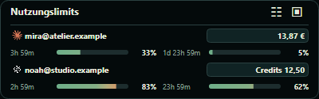

# UseScope für macOS – Vorschau

Es gibt getrennte Pakete für **Apple Silicon** (`osx-arm64`) und **Intel**
(`osx-x64`). Nicht das Windows-ZIP auf dem Mac verwenden.
Als Mindestversion ist macOS 15 vorgesehen.



ZIP entpacken, `UseScope.app` nach Programme oder in einen eigenen Programmordner
verschieben und öffnen. Das Menüleistensymbol bietet Widget, Kontoverwaltung,
Aktualisieren, Hell/Dunkel und Beenden. Die Oberfläche nutzt die gleiche kompakte
Kontenansicht; die Mac-Kontoverwaltung steht in einem eigenen Fenster zur Verfügung.

## Aktueller Prüfstand

Die Mac-Version ist als **Vorschau** vorbereitet. Gemeinsame Datenlogik,
Anbieter-Mapping, virtuelle UI-Darstellung und Paketstruktur werden automatisiert
geprüft. Eine echte Abnahme von Menüleiste, Fenstern, Anmeldung, Schlüsselbund und
Netzwerkabfragen auf macOS steht noch aus. Diese Prüfungen sind keine Mac-Abnahme.

Die Pakete sind nicht mit einer Developer-ID signiert und nicht notarisiert.
macOS kann den Start daher blockieren. Vor einem öffentlichen regulären Release
müssen Signierung, Notarisierung und ein Test auf echten Macs abgeschlossen werden.
Sicherheitsfunktionen nicht deaktivieren oder Quarantäneattribute pauschal entfernen.

## Konten und Daten

Die Anbieterprogramme Codex, Claude Code und Hermes müssen auf dem Mac separat
installiert sein. Das Hinzufügen eines CLI-Kontos öffnet für die Anmeldung Terminal
mit der nativen Anbieter-CLI. Die Anmeldung schließt du selbst ab. Die App enthält
keine auf einem Windows-PC gespeicherten Logins und übernimmt solche nicht.

Daten liegen unter `~/Library/Application Support/UseScope`. Jede Anmeldung hat
ein eigenes Profil. Claude-Zugangsdaten können im macOS-Schlüsselbund unter einem
profilbezogenen Eintrag liegen. macOS kann die Zustimmung zum Lesen dieses Eintrags
verlangen. UseScope liest nur den zum gewählten Profil gehörenden Eintrag und fällt
nicht auf einen fremden Standard-Account zurück. Diese Anbindung muss auf der
installierten Claude-Code-Version noch praktisch geprüft werden.

Der Windows-Autostart und der globale Windows-Hotkey sind in der Mac-Vorschau nicht
enthalten. macOS-Anmeldeobjekte können nach der Abnahme über die Systemeinstellungen
eingerichtet werden. Escape blendet das aktive Widget aus. Weitere Unterschiede
werden vor Freigabe nach einem Mac-Test dokumentiert.

## Bauen

.NET 10 SDK, PowerShell 7 und Python 3 werden benötigt:

```powershell
.\tools\build-mac.ps1
```

Der Build kann auf Windows oder macOS erzeugt werden. Er erzeugt beide Architekturen,
ein echtes `.app`-Bundle, Lizenzinventar, Manifest und ZIP-Prüfsumme. Unix-Ausführungsrechte
werden im ZIP explizit gesetzt. Auf macOS prüft der CI-Job zusätzlich den nativen
Start im Offline-Testmodus. Auch dann werden keine echten Konten oder sichtbaren
Fenster geöffnet.

API- und Portal-Verbindungen entsprechen der [Anbieterliste](PROVIDERS.md). Eigene API-Schlüssel werden über Security.framework im macOS-Schlüsselbund gespeichert. Die Hintergrundabfrage öffnet keine Zustimmungsdialoge. Speicherung, Leserechte und Löschung sind auf einem echten Mac noch abzunehmen.
